# Issue/PR triage

Triage reads every new issue and PR in
[vllm-project/vllm](https://github.com/vllm-project/vllm). Claude labels each
one: model, hardware, serving config, area, severity, and slop signals. Code
then scores its impact as P0–P3 and routes the important ones to the
maintainer they are most likely for. Maintainers work their queue on
[ci.vllm.ai/triage](https://ci.vllm.ai/triage).

- **Who it's for.** vLLM maintainers only. The dashboard shows LLM judgements
  about contributors' work, so nothing is public.
- **Status.** A pilot with three maintainers (`gau-nernst`, `khluu`,
  `AndreasKaratzas`) plus beta testers. Everyone in
  [`config/maintainers/`](config/maintainers/) is routed items.
- **Slack is in shadow mode.** Every DM and digest is rendered and stored but
  not sent (see [Slack delivery](#8-notifications-and-slack)). Beta testers have
  `notify_mode: "off"` and use the dashboard only.

Deeper docs (this page links to them rather than repeating them):

| Doc | What's in it |
|---|---|
| [docs/data-model.md](docs/data-model.md) | The data contract: `prepass`, `facets`, scores, assignment statuses and actions, rules, relevance |
| [config/maintainers/README.md](config/maintainers/README.md) | For maintainers: how items reach you, writing notes, your file, allowed values |
| [docs/triage-dashboard.md](../docs/triage-dashboard.md) | Dashboard pages, access model, Vercel env, OAuth app setup, Slack buttons, security notes |
| [deploy/triage-extractor/README.md](../deploy/triage-extractor/README.md) | The extractor host: what the model can do, budget, setup |
| [deploy/aws/README.md](../deploy/aws/README.md), [disaster-recovery.md](../deploy/aws/disaster-recovery.md) | The alerting worker that runs the triage timers |
| [migrations/README.md](../migrations/README.md) | The migration runner |

**Contents:** [Pipeline](#pipeline) ·
[Where things run](#where-things-run) · [Maintainers](#maintainers) ·
[Operating it](#operating-it) · [Limitations and next ideas](#known-limitations-and-next-ideas)

## Pipeline

```mermaid
flowchart LR
  GH[(GitHub<br/>vllm-project/vllm)] -->|"triage-ingest<br/>worker, every 5 min"| ITEMS[triage_items<br/>+ prepass]
  BK[(Buildkite PR builds<br/>+ Main CI job tables)] -->|"triage-ingest<br/>open P0–P2 PRs"| CI[triage_pr_ci]
  CI -->|whose move| ITEMS
  ITEMS -->|"vllm-triage extract<br/>extractor host, cron 10 min"| EXT[triage_extractions<br/>facets]
  EXT -->|"triage-route<br/>worker, every 5 min"| SCORES[triage_scores<br/>P0–P3]
  SCORES -->|"vllm-triage relevance<br/>extractor host, Opus"| REL[triage_relevance]
  PROF[triage_maintainer_profiles<br/>6 months of PRs + feedback] --> REL
  REL --> ROUTE{{"triage-route<br/>choose owners,<br/>issue + fix PR groups"}}
  SCORES --> ROUTE
  MAINT[config/maintainers/*.yaml<br/>on main] -->|synced each route run| ROUTE
  ROUTE --> ASSIGN[triage_assignments]
  ASSIGN -->|"P0 DM now; triage-digest hourly"| OUTBOX[alerting_notification_outbox<br/>shadow]
  ASSIGN --> DASH[ci.vllm.ai/triage]
  DASH -->|buttons| ACT[triage_actions]
  ACT --> ROUTE
  GH -.->|"closed / reopened / commented"| ASSIGN
```



| Step | Runs | Code | Output |
|---|---|---|---|
| [Ingest](#1-ingest) | worker, `triage-ingest`, every 5 min | `pipeline.IngestHandler`, `github_graphql.py` / `github.py`, `prepass.py` | `triage_items` with `prepass` |
| [PR CI status](#2-pr-ci-status) | worker, `triage-ingest` | `ci.py`, `pipeline.IngestHandler._refresh_pr_status` | `triage_pr_ci`, `prepass.waiting_on` |
| [Extract](#3-extraction-claude) | extractor host, cron every 10 min | `extract.py`, `facets.py`, `assets/extractor-system.md` | `triage_extractions.facets` |
| [Score](#4-scoring) | worker, `triage-route`, every 5 min | `scoring.py`, `config/scoring.yaml`, `config/tiers.yaml` | `triage_scores` |
| [Relevance](#5-relevance) | extractor host, same cron run, after extract | `relevance.py` | `triage_relevance` |
| [Route](#6-routing) | worker, `triage-route` | `pipeline.RouteHandler`, `routing.py`, `groups.py` | `triage_assignments` |
| [Follow GitHub](#7-following-github) | worker, `triage-route` | `store.follow_github` | assignment status |
| [Notify](#8-notifications-and-slack) | worker, `triage-route` (P0) and `triage-digest` (hourly) | `notify.py` | outbox rows (shadow) |
| Act | dashboard and Slack buttons | `src/app/api/triage/*` | `triage_actions` |

### 1. Ingest

- **GraphQL by default, batched.** One query lists the issues and PRs updated
  since the cursor (labels, assignees, reactions, comment count; for PRs also
  draft state, closing issue references, review decision, mergeability and
  head-commit checks). Then one query per 25 items fetches PR files (up to
  300), comments (first 30, only for in-scope items whose comment count
  changed), the authors of the last 30 comments, and the authors of PRs the
  item names.
- **REST fallback.** `TRIAGE_GITHUB_API=rest` switches back to the REST client
  (one request per PR's files, comments and named PR). REST can't read
  checks or reviews, so "waiting on the author" then only sees drafts.
- **Cursor.** Each run reads from the stored cursor (`triage_cursors`) minus a
  10-minute overlap, at most 1000 items. The first run looks back 2 days.
- **Scope** (`prepass.scope_reason`). Only items **opened in the last 30
  days** (`scope.max_age_days` in `config/scoring.yaml`) are triaged:
  - in scope: issues; PRs from non-maintainers (`pr_external`); maintainer PRs
    that link an issue (`pr_linked_issue`, regex or the "Development" sidebar);
  - stored but not extracted: bot PRs and issues (`bot`), maintainer PRs with
    no linked issue (`pr_maintainer_unlinked`), and anything older than the
    window (`too_old`). "Maintainer" means GitHub's author association is
    OWNER, MEMBER or COLLABORATOR.
  - Each route run takes items out of scope as they age past the window and
    deletes router assignments on them that nobody acted on.
- **Prepass** (deterministic, `prepass.py`): areas from changed paths and labels
  (`config/areas.yaml`, seeded from vLLM's mergify rules), linked issues,
  hardware and model mentions, commenters, GitHub assignees, the authors of
  named PRs, the issues a PR fixes (`fixes_issues`: closing references and
  "Fixes/Closes/Resolves #N", not "related to #N"), and for open PRs whose
  move it is (`waiting_on`: `author` when draft, pre-commit or DCO failing,
  its finished CI build fails jobs main doesn't share (see below), merge
  conflicts, or changes requested). Each run also re-reads the status of up
  to 50 held-back P1 PRs plus the PRs whose CI is due, because a check
  finishing doesn't change a PR's `updatedAt`.
- New text (title, body, comments, files) changes `content_hash` and re-queues
  extraction.

### 2. PR CI status

Done by `triage-ingest` (`ci.py`) when the worker has `BUILDKITE_TOKEN` (the
alerting worker's read-only Buildkite token); without it CI status isn't tracked.

- **Which PRs.** Open, in-scope P0–P2 PRs, re-checked every 10 minutes for P0/P1
  and every hour for P2 (`store.CI_REFRESH`), at most 150 per run, in the same
  batched GitHub status query as the held-back PRs.
- **The build.** GitHub's `buildkite/ci/pr` status on the head commit points at
  the Buildkite build. No such status means `not_started` (nobody ran `/ci
  run`). The build is fetched from Buildkite (one REST call, jobs embedded, at
  most 15 per run) only while it is new or unfinished.
- **Counts.** Script jobs, latest attempt: passed, running, failed (failed or
  timed out). Each failed job is matched against the Main CI tables the
  alerting worker keeps (`alerting_main_ci_job_states` / `_job_alerts`):
  **also failing on main** now, **failed on main in the last 7 days**
  (`MAIN_RECENT_DAYS`, flaky), or **only on this PR**. Jobs that lost their
  agent don't count as the PR's. If Main CI hasn't scanned for an hour
  (`store.MAIN_CI_MAX_LAG`), `main_known` is false and no failure is called the PR's.
- **Whose move.** With `CI_PR_ONLY_FAILURES_WAIT_ON_AUTHOR` (on), a finished,
  failed build with at least one PR-only failure makes the PR the author's
  move (`waiting_reasons` gets `ci_pr_failures`). Running builds and failures
  main shares don't. Set it to `False` to go back to pre-commit/DCO only.
- **Shown** as a CI pill on queue rows, a CI section in the drawer, and a short
  fragment on PR lines in Slack. Stored in `triage_pr_ci` (migration 0044); see
  [docs/data-model.md](docs/data-model.md#triage_pr_ci-migration-0044-triagecipy).

### 3. Extraction (Claude)

Runs only on the extractor host, through `deploy/triage-extractor/run-extractor.sh`
(cron every 10 minutes). The script runs `vllm-triage extract`, then
`vllm-triage relevance`, under `flock -n ${XDG_RUNTIME_DIR:-/tmp}/vllm-triage-extractor.lock`
(cron has no `XDG_RUNTIME_DIR`, so it's `/tmp/...`). A run that finds the lock
held exits without doing anything. It logs to `~/.local/state/vllm-triage/extractor.log`.

- **Claude Code CLI, headless:** `claude -p --model sonnet --tools ""
  --strict-mcp-config --setting-sources "" --no-session-persistence
  --output-format json --json-schema <FACETS_SCHEMA>`, in an empty temporary
  directory. The system prompt is passed with `--system-prompt-file`, because
  the relevance prompt (with every maintainer's PRs) is larger than Linux's
  128 KiB limit for a single argument.
- **Environment allowlist** (`extract.claude_env`): only `PATH`, `HOME`,
  locale, `TMPDIR`, `XDG_*`, `CLAUDE_CONFIG_DIR` and `CLAUDE_CODE_OAUTH_TOKEN`
  reach the process. `DATABASE_URL`, cloud credentials and `ANTHROPIC_API_KEY`
  never do, so usage always lands on the Claude plan.
- **Model:** `TRIAGE_MODEL` (default `sonnet`). Prompt version `v1`
  (`facets.PROMPT_VERSION`).
- **Queue:** in-scope items with status `pending`/`failed`, highest
  `prepass_priority` first (crash/regression keywords, hardware and model
  mentions, reactions). Items are leased for 30 minutes and tried at most 3
  times. A timeout is 180 s per item. 2 workers.
- **Budget:** `TRIAGE_MAX_ITEMS_PER_RUN` (default 40), `TRIAGE_MAX_ITEMS_PER_DAY`
  (150) and `TRIAGE_MAX_TOKENS_PER_DAY` (2,000,000), counted over the last 24
  hours from `triage_extractions`. The first "usage limit" or "rate limit"
  answer from Claude stops the run and puts the leased items back.
- **Untrusted input.** Item text goes into an escaped, delimited `<item>`
  block. The model has no tools and can't act. Its output is re-validated
  (`facets.normalize_facets`): unknown enum values are dropped. It never sets
  a score, an owner or a label. The system prompt asks it to flag prompt
  injection as a slop signal.

### 4. Scoring

Deterministic (`scoring.py`). The breakdown's points always sum to the score.

```
score = max(0,
          severity × reach            # the largest severity flag, scaled
        + type + popularity + recency + evidence + social
        + PR factors + slop penalty)
reach = model tier × hardware tier × config      # e.g. 1.0 × 1.0 × 1.15
```

- **Severity** (largest one only): serving broken 50, security 50 (never
  scaled by reach), wrong output 42, crash 36, hang 32, memory regression 18,
  perf regression 9 per 10 % (cap 40). For issues it only counts if the type
  is a defect (bug, regression, perf_regression, performance, ci). A PR gets
  half (`pr_fraction: 0.5`).
- **Reach**: model tier1/tier2/other/unknown ×1.0/0.8/0.6/0.75; hardware
  ×1.0/0.8/0.55/0.85; default config ×1.15, exotic ×0.55, unknown ×0.9. Tier
  lists are in `config/tiers.yaml`.
- **Additive**: type (regression +12, perf_regression +10, ci +4, bug +3,
  spam −100 and band P3), popularity (model +6/+3, hardware +3/+1), affects
  the latest release +10 (or main +4), has a repro +4, low extraction
  confidence −6, social 0.5 per reaction + 0.4 per comment (cap 15).
- **PRs**: fixes an open issue in the queue = 0.6 × that issue's score
  ("linked-issue credit", from the regex, the sidebar link or the facets'
  `fixes_issues`), hot path +6, tests +2, size xs/s +2 … xl −4, low effort
  −25, draft −15.
- **Slop**: −10 per LLM-reported signal, at most −40.

| Band (stored) | Shown as | Score | What happens |
|---|---|---|---|
| `page` | **P0** | ≥ 70 | routed (with a backup), immediate DM |
| `route` | **P1** | 40–69 | routed, daily digest |
| `watch` | **P2** | 20–39 | dashboard only |
| `ignore` | **P3** | < 20, or spam | dashboard only, collapsed |

**Re-scoring.** `triage-route` re-scores an in-scope item when it has no score,
has a new extraction, changed on GitHub, the config version changed, or (for a
PR) an issue it links or fixes was scored after it. The config version is
`scoring.yaml` `version` + `tiers.yaml` `version`: bump it when you change
weights, and the next run re-scores every open item with no LLM calls.
`/triage/scoring` mirrors these numbers (`src/lib/triage-scoring-config.ts`,
with a test that fails if they drift).

### 5. Relevance

Who an item is for, judged by Claude from what each maintainer works on
(`relevance.py`).

- **Profiles** (`triage_maintainer_profiles`). Built by the worker: each
  maintainer's PRs from the last 6 months, up to 120 authored and 120 reviewed
  (GitHub search API, spaced for its 30/min limit). Rebuilt when older than
  24 hours.
- **Notes.** The free text in each maintainer's file (`notes`, stored as
  `rules.natural_language`, max 4000 chars).
- **Feedback.** At each rebuild the worker snapshots what the person did with
  routed items in the last 60 days, at most 15 of each kind: items they said
  "Not mine" to and items they acked or finished ("took"). Claude reads them
  as evidence against or for similar items. (The worker builds this because
  the extractor's role can't read actions or assignments.)
- **The call.** One `claude -p` call per item judges every maintainer who still
  needs it. All profiles are in the (cached) system prompt. Model
  `TRIAGE_RELEVANCE_MODEL` (default `opus`: it followed the "medium = same
  component" rule much better than Sonnet). Prompt version `rel-v4`.
- **Levels:** high (their code path or the likely cause), medium (a specific
  component they *author* in, never a broad category), low, none. Evidence PRs
  must come from that maintainer's own profile. A "don't send me" in the notes
  always wins.
- **`reason_local`.** For a maintainer with `language: vi`, Claude also writes a
  one-sentence reason in Vietnamese that Slack DMs use.
- **Queue.** Open, extracted items scoring ≥ `TRIAGE_RELEVANCE_MIN_SCORE` (40),
  highest first, up to `TRIAGE_RELEVANCE_PER_RUN` (40) items per run, 2
  workers. Not leased: run only one at a time (hold the cron lock).
- **When it re-judges.** A judgement is current while both the item's
  `content_hash` and the maintainer's `profile_hash` match. The profile hash
  covers the prompt version, their PR list, notes, language (with
  `LOCAL_REASON_VERSION`) and feedback titles. So: new item text re-judges that
  item for everyone; editing notes or a daily rebuild that changes someone's PRs
  or feedback re-judges everything for that person; bumping `PROMPT_VERSION`
  re-judges everything for everyone (see [Costs](#costs)).

### 6. Routing

`triage-route` considers up to 200 candidates per run, highest score first:
open, in scope, P0/P1, no open/acked/done primary owner, and no `drop`/`slop`.

**Held back (stays on the dashboard, unowned):**

- **Waiting on the author:** a P1 PR that is a draft, fails pre-commit or DCO,
  has a finished CI build with failures main doesn't share, has merge
  conflicts, or has changes requested. It's routed once it's the
  reviewers' move. P0 PRs are routed anyway.
- **Assigned elsewhere:** it has GitHub assignees and none of them is a triage
  maintainer.
- **Waiting for relevance:** unless a maintainer is already involved, routing
  waits until every active maintainer has a current judgement, but only for
  **2 hours** (`RELEVANCE_GRACE`) from when the item became routable (entered
  P0/P1, or was first extracted, whichever is later). After that it routes
  among those judged and logs who was missing. A missing judgement never counts
  as a match.

**Who qualifies** (`routing.choose_owners`), strongest first:

1. **Involved:** assigned to them on GitHub, they wrote a PR the item names
   (for example, the commit a regression was bisected to), or they commented.
2. **Relevance** high or medium.
3. **Rules** in their file: any one of `areas`, `hardware`, `models` (globs),
   `paths` (globs), `keywords` (title or summary) matches, with an optional
   `types` filter.

`exclude` (types, areas, hardware) blocks relevance and rules but not
involvement. A hardware exclude only applies when *all* of the item's hardware
is excluded. Low or none never routes.

**Always applied:** `active`, `min_score`, `away` dates, and never back to
someone who said "Not mine" for that item.

**Capacity.** `capacity_per_week` counts primary assignments from the last 7
days that the person kept. Not mine, reassigned away, and closed on GitHub
before they acked it don't count. A P0 may go over the cap only if it is
**fresh** (opened in the last 3 days) or a **clear match** (involved or high).

**Issue + fix PR groups** (`groups.py`). A PR fixes an issue when its
`prepass.fixes_issues` or Claude's `facets.pr.fixes_issues` names it. An issue
and its fix PRs are a group:

- If a member already has an open or acked primary owner, the other members go
  to that person (reason `fixes #N` / `fixed by #N`), before any relevance wait,
  unless they said "Not mine" to it, exclude it, are away, or the group's
  highest score is under their `min_score`. Capacity doesn't apply.
- If nobody owns the group, the item is routed as usual but at the group's
  highest score and band (a P1 PR fixing a P0 issue goes as a P0). The other
  unowned members that are routing candidates follow it in the same run, with
  one P0 DM for the group.
- A group takes **one** capacity slot: followers carry `reason.grouped_with`
  and aren't counted.

**Two passes.** Pass 1 gives every clear match (involved or high) its slot
across the whole queue. Pass 2 lets medium and rule matches use what's left.
Ties go to the lower load/capacity, then login. Owners: the best candidate is
**primary**. A P0 also gets a **backup**, who must be a clear match.

**What people do** (dashboard or Slack, `triage_actions`): Ack, Not mine (closes
it; the item is routed again without them), Reassign, Drop and Slop (never
routed again), Done, Reopen. Ack, Not mine, Done and Reassign on an issue
also apply to its fix PRs held by the same person (each gets its own action
row, note `with #N`). Drop, Slop and Reopen apply only to the item clicked. If someone drops or slops 10+ items in 24 hours
(`TRIAGE_SUPPRESSION_ALERT`), the queue and the team digest warn about it.
Details: [docs/data-model.md](docs/data-model.md#assignment-status-and-actions).

### 7. Following GitHub

Every route run, before routing (`store.follow_github`):

| On GitHub | Assignment |
|---|---|
| Closed or merged | open/acked → `done` with `closed_by: github`; frees capacity |
| Reopened (still in the window) | back to its previous status, unless the role was filled since |
| The assignee comments after it was assigned | open → `acked` (`acked_by: github_comment`) |

### 8. Notifications and Slack

| Message | When | To |
|---|---|---|
| **P0 DM** | when assigned (also every assignment for `notify_mode: immediate`) | primary and backup |
| **Daily digest** | hourly timer; goes out in the hour where the person's local time is `digest_hour` (default 9) in their `timezone` (default UTC), at most once per local day | each maintainer with new items or reminders |
| **Still waiting** (in the digest) | their open items assigned 3+ days ago and not acked, oldest first, max 5 | same |
| **Team digest** | 15:00 UTC | `TRIAGE_DIGEST_CHANNEL` (none if unset): top 30 new P0/P1 of the day, plus the drop/slop warning |

- Nothing is sent for `notify_mode: "off"` or without `slack_user_id`. A
  digest lists at most 20 new items. A day with nothing new and nothing
  waiting sends no digest.
- **Groups.** A digest or P0 DM shows an issue with its fix PRs as one entry
  ("↳ fix: #N title"), at the band of its most urgent member. Its buttons act
  on the issue, which also covers the fix PRs (see Routing). "Still waiting"
  skips an issue whose fix PR has merged.
- **CI.** PR lines carry a short CI fragment (e.g. "CI: not started", "2
  running", "1 failed · only on this PR").
- **Buttons.** DMs have Ack / Not mine / Reassign / Open in dashboard. Slack
  posts clicks to `https://ci.vllm.ai/api/triage/slack/interactions`. The
  route checks `SLACK_SIGNING_SECRET` (and rejects requests older than 5
  minutes), maps the Slack user to a maintainer by `slack_user_id`, and only
  lets the assignee act. See
  [docs/triage-dashboard.md](../docs/triage-dashboard.md#slack-buttons).
- **Language.** `language: vi` switches the bot's wording to Vietnamese and
  uses `reason_local`. Only `en` and `vi` exist.
- **Delivery mode: the kill switch.** Messages are delivered only when
  **both** switches are on:
  1. the worker env has `TRIAGE_SLACK_ENABLED=1` (from the alerting worker's
     Secrets Manager secret), **and**
  2. the S3 control `control/triage.mode` is `live` (`run-worker` turns it
     into `ALERTING_DELIVERY_MODE`).

  Otherwise every DM and digest is stored in `alerting_notification_outbox`
  with `delivery_mode = 'shadow'`, which the dispatcher never leases (so shadow
  rows are never sent later either). Setting the control to `disabled` stops
  the three triage timers altogether. Code: `triage.worker.triage_delivery_mode`.

## Where things run

### Alerting worker (AWS)

The shared alerting worker runs the triage consumers as systemd oneshots
(`deploy/aws/systemd/`). Each runs `/opt/alerting/bin/run-worker <consumer>`,
which loads secrets and then runs `python -m triage.worker <consumer>`. After
the command, it dispatches any due outbox rows.

| Timer | Schedule (UTC) | Does |
|---|---|---|
| `alerting-triage-ingest.timer` | every 5 min (`*:00/5`) | GitHub → `triage_items`; PR CI status → `triage_pr_ci` |
| `alerting-triage-route.timer` | every 5 min, offset 2 min (`*:02/5`) | sync maintainers, expire old items, follow GitHub, rebuild stale profiles, re-score, route, P0 DMs |
| `alerting-triage-digest.timer` | hourly (`*:00`) | maintainer digests at their local hour; team digest at 15:00 |

The units discard stdout and stderr (so logs don't capture credentials or
model output). Warnings such as "maintainer files rejected" or "considered
with partial judgements" therefore go nowhere. A failed run does reach the
worker-failure notifier (`alerting-failure-notify@`). Credentials come from
the alerting worker's Secrets Manager secret (`DATABASE_URL`,
`SLACK_BOT_TOKEN`, `BUILDKITE_TOKEN`, `TRIAGE_*`) and the read-only GitHub secret
(`GITHUB_TOKEN`).

### Extractor host

A machine (currently a maintainer's devbox) where Claude Code is logged in with
a Pro/Max plan. The plan login never reaches AWS or Vercel. It runs
`deploy/triage-extractor/run-extractor.sh` from cron:

```
*/10 * * * * /path/to/checkout/deploy/triage-extractor/run-extractor.sh
```

The env file is `~/.config/vllm-triage/extractor.env`; the script refuses to run unless it is `chmod 600`.
Setup: [deploy/triage-extractor/README.md](../deploy/triage-extractor/README.md).

**Restricted DB role `triage_extractor`** (`deploy/triage-extractor/extractor-role.sql`,
plus grants in migration 0039):

| Can | Can't |
|---|---|
| read `triage_items`; update only its extraction status columns | read `triage_assignments`, `triage_actions`, `triage_cursors`, `triage_pr_ci`, the outbox, or any non-triage table |
| read/insert/update `triage_extractions` and `triage_relevance` | write items' content, scores, maintainers, profiles |
| read `triage_scores`, `triage_maintainers`, `triage_maintainer_profiles` | |

Tested by `tests/test_postgres.py::test_extractor_role_can_extract_and_nothing_else`.

### Postgres tables

Defined in migrations `0038_triage.sql`, `0039_triage_relevance.sql`,
`0042_triage_relevance_reason_local.sql` and
`0043_triage_routing_grace_and_feedback.sql` and `0044_triage_pr_ci.sql`.
Row-level security is on for all of them.

| Table | One line |
|---|---|
| `triage_items` | one row per issue/PR: text excerpts, files, `prepass`, `content_hash`, scope, extraction status |
| `triage_extractions` | Claude's facets per (item, content hash, prompt version), with tokens and duration |
| `triage_pr_ci` | per open P0–P2 PR: CI state of the head commit's Buildkite build, job counts, failed jobs and whether main shares them |
| `triage_scores` | current score, band, breakdown, scoring version, `routable_since` |
| `triage_relevance` | per (item, maintainer): high/medium/low/none, evidence PRs, `reason`, `reason_local`, the hashes it was judged against |
| `triage_maintainers` | synced from the YAML files (`updated_by = 'repo'`), plus bare rows the dashboard creates when an unlisted person acks |
| `triage_maintainer_profiles` | per maintainer: recent PRs, feedback snapshot, `profile_hash`, `built_at` |
| `triage_assignments` | who owns what: role (primary/backup), status, reason, `notified_at` |
| `triage_actions` | every button press (actor, action, source `dashboard`/`slack`/`cli`) |
| `triage_cursors` | ingest cursor per source (`github:vllm-project/vllm`) |
| `alerting_notification_outbox` | shared with alerting; triage rows have `alert_path = 'triage'` |

### Dashboard

Next.js on Vercel, at [ci.vllm.ai/triage](https://ci.vllm.ai/triage). It
deploys on merge to `main`.

- **Tabs:** Queue (`/triage`), My list (`/triage/me`), Configure rules
  (`/triage/rules`, draft and preview; nothing is saved).
- **Header reference links:** How it works (`/triage/guide`) and Scoring
  guidelines (`/triage/scoring`), above the tabs. The item drawer also links
  to scoring guidelines from its score breakdown.
- **Queue views:** Needs triage, Not acked, Ready to review, Ready to merge,
  Suggested to close, All. Suggested to close includes every priority, including P3/unscored:
  open PRs sharing a fix target with another open PR, or flagged with
  `pr.low_effort` / `slop_signals`. These are review candidates, not confirmed
  duplicates. Link matching uses both prepass and extracted fix references.
- **Quick views in Filters:** Fires (serving broken, security, or regression
  signals), Has fix PR (open P0/P1 issues with an open fix PR), Stale (>3d),
  and Waiting on author / CI. Quick views clear owner/status constraints;
  further filters can narrow them. Stale means unowned for over 3 days since
  becoming routable, or a primary assignment unacked for over 3 days.
- **Ready to merge:** non-draft PRs with approved reviews, known
  mergeability, a successful GitHub check rollup, and passed Buildkite CI
  for the same observed head. The snapshot expires after one hour. Missing
  data never counts as ready; GitHub remains the final merge authority.
  Deploy the updated ingest worker to populate the new JSON prepass fields
  on subsequent ingest/status refresh runs; no migration or re-extraction is
  needed. Until then this view is empty. The existing CI refresh cadence and
  budgets apply, so a stale/unrefreshed PR can be omitted conservatively.
- **Queue rows:** a CI pill on open P0–P2 PRs ("CI ✓", "CI 20/41", "CI 3 ✗",
  "CI 3 ✗ (main)", "CI not run"). A fix PR is nested under its issue
  ("↳ fix"); other rows say "Fixes #N" / "Fixed by #N". My list nests fix PRs the same way.
- **Item drawer:** for PRs a CI section (job counts, failed jobs linked to
  Buildkite and marked against main, and whether that makes it the author's
  move; `src/lib/triage-ci.ts`), the group with links and owners, the score breakdown, who it's for, and, for an unowned
  P0/P1, **why it has no owner** (`src/lib/triage-why-unowned.ts`, a mirror of
  the router; keep them in step).
- **Pipeline health** line at the top of the queue: when Claude last labelled
  and judged, what's waiting, failures, and the Claude login expiry
  (`src/lib/triage-health.ts`).
- **Access:** 404 unless `TRIAGE_ENABLED=1`. GitHub OAuth (`read:org`), only
  for active members of `TRIAGE_MAINTAINER_TEAM` (`org/team-slug`) or logins in
  `TRIAGE_ALLOWED_LOGINS`. The token is used for that one check and discarded.
  The session is a signed 12-hour cookie. Writes need a same-origin `Origin`
  (CSRF). The Slack endpoint checks Slack's signature. Details:
  [docs/triage-dashboard.md](../docs/triage-dashboard.md#access-model).

## Maintainers

One file per person: [`config/maintainers/<github_login>.yaml`](config/maintainers/).
The maintainer-facing guide is [config/maintainers/README.md](config/maintainers/README.md).

| Field | Default | Meaning |
|---|---|---|
| `github_login` | required | must equal the file name |
| `slack_user_id` | none | `U…`; needed for DMs and Slack buttons |
| `notes` | none | free text Claude reads for relevance ("send me…", "don't send me…") |
| `rules` | none | optional `areas`, `hardware`, `models`, `paths`, `keywords`, `types`, and `exclude: {types, areas, hardware}` |
| `min_score` | 40 | only items scoring at least this (0–200) |
| `capacity_per_week` | 10 | primary assignments per 7 days (1–100) |
| `notify_mode` | `digest` | `immediate`, `digest` or `"off"`. **Quote `"off"`**: bare `off` is YAML for `false`, and that rejects the whole set |
| `away` | none | `[{start: YYYY-MM-DD, end: YYYY-MM-DD}]`; no routing in those dates |
| `language` | `en` | `en` or `vi` |
| `timezone` | UTC | IANA name, e.g. `Europe/London` |
| `digest_hour` | 9 | local hour 0–23 for the daily digest |
| `active` | true | `false` pauses routing |

**Adding a person:**

1. Add `<login>.yaml` with `notes` (what they own, what not to send),
   `notify_mode: "off"` until Slack is live, and `timezone`. A Slack ID can
   wait in a comment.
2. Make sure they can sign in: they need to be in `TRIAGE_MAINTAINER_TEAM` or
   `TRIAGE_ALLOWED_LOGINS` (Vercel env).
3. Validate, then open a PR (CI runs the same check, `.github/workflows/triage.yml`):
   ```bash
   uv run --project triage python -m triage.maintainers check triage/config/maintainers
   ```
4. After merge, the next `triage-route` run (within about 5 minutes) syncs the
   files from `main` and builds their profile. The next relevance runs then
   judge every open P0/P1 item for them (see [Costs](#costs)).

**Removing:** delete the file (the row is deactivated) or set `active: false`.

**A broken file** (bad YAML, unknown key, unknown area, file name ≠ login,
bare `off`): the whole set is rejected and the last good rules stay in the
database. Nobody's rules change until it's fixed, and the worker says so only
in a log that is discarded, so rely on the CI check.

## Operating it

### Configuration

**Alerting worker** (from its secrets; changes apply on the next run, no deploy needed):

| Variable | Default | Purpose |
|---|---|---|
| `DATABASE_URL` | required | owner/worker connection |
| `GITHUB_TOKEN` | required for ingest | read-only token (GitHub secret); also used for profiles and fetching maintainer files |
| `TRIAGE_GITHUB_API` | `graphql` | `rest` switches ingest back to REST |
| `TRIAGE_SLACK_ENABLED` | unset | `1` is one of the two Slack switches |
| `TRIAGE_DIGEST_CHANNEL` | unset | Slack channel for the team digest; none if unset |
| `TRIAGE_SUPPRESSION_ALERT` | 10 | drops+slops in 24 h by one person that trigger the warning |
| `BUILDKITE_TOKEN` | shared | read-only Buildkite token; PR CI status is off without it |
| `SLACK_BOT_TOKEN` | shared | the alerting Slack bot |
| S3 `control/triage.mode` | `shadow` | `shadow`, `live` or `disabled` |

**Extractor host** (`~/.config/vllm-triage/extractor.env`):

| Variable | Default | Purpose |
|---|---|---|
| `DATABASE_URL` | required | the restricted `triage_extractor` role, never the owner URL |
| `TRIAGE_MODEL` | `sonnet` | extraction model |
| `TRIAGE_MAX_ITEMS_PER_RUN` / `_PER_DAY` / `TRIAGE_MAX_TOKENS_PER_DAY` | 40 / 150 / 2,000,000 | extraction budget |
| `TRIAGE_RELEVANCE_MODEL` | `opus` | relevance model |
| `TRIAGE_RELEVANCE_MIN_SCORE` | 40 | only judge items at or above this |
| `TRIAGE_RELEVANCE_PER_RUN` | 40 | items judged per run |
| `CLAUDE_CODE_OAUTH_TOKEN` | unset | long-lived plan token from `claude setup-token` |
| `CLAUDE_CONFIG_DIR` | unset | if the login lives somewhere other than `~/.claude` |
| `TRIAGE_EXTRACTOR_ENV` | `~/.config/vllm-triage/extractor.env` | (read by `run-extractor.sh`) env file path |

**Constants in code** (change by PR): `ci.CI_PR_ONLY_FAILURES_WAIT_ON_AUTHOR`
(True), `ci.MAIN_RECENT_DAYS` (7), `store.CI_REFRESH` (P0/P1 10 min, P2 60
min), `store.MAIN_CI_MAX_LAG` (1 h), `pipeline.RELEVANCE_GRACE` (2 h),
`pipeline.FRESH_WINDOW` (3 days), `notify.WAITING_AFTER_DAYS` (3).

**Dashboard** (Vercel): `TRIAGE_ENABLED`, `NEXT_PUBLIC_TRIAGE_ENABLED`,
`GITHUB_OAUTH_CLIENT_ID`, `GITHUB_OAUTH_CLIENT_SECRET`, `TRIAGE_SESSION_SECRET`,
`TRIAGE_MAINTAINER_TEAM`, `TRIAGE_ALLOWED_LOGINS`, `SLACK_SIGNING_SECRET`,
`TRIAGE_CLAUDE_LOGIN_EXPIRES`, `TRIAGE_CANONICAL_ORIGIN`,
`TRIAGE_SUPPRESSION_ALERT`, `TRIAGE_DEV_LOGIN` (local only), `DATABASE_URL`.
What each does: [docs/triage-dashboard.md](../docs/triage-dashboard.md#environment-variables-vercel).

### Commands

Run from `triage/` (`uv run --extra postgres …` where a database is needed):

| Command | What |
|---|---|
| `vllm-triage extract [--model M --workers N --max-items-per-run …]` | one budgeted extraction run (extractor host) |
| `vllm-triage relevance [--model M --min-score N --limit N --workers N]` | one relevance run (extractor host) |
| `vllm-triage sync-maintainers [--dir D]` | sync local maintainer files into the database now (normally the route run does it from `main`) |
| `vllm-triage github-check [--minutes 30]` | read-only, no DB: can this token run the GraphQL ingest, and what does it cost |
| `vllm-triage backtest fetch\|extract\|report --dir D` | offline: fetch N days, extract with Claude (resumable), write `report.html` and a labelling sheet; `report` re-scores for free |
| `python -m triage.maintainers check config/maintainers` | validate maintainer files |
| `python -m triage.worker triage-ingest\|triage-route\|triage-digest` | one consumer run (what the timers call) |

For a manual `extract` or `relevance` on the extractor host, hold the cron
lock (`flock /tmp/vllm-triage-extractor.lock …`), because relevance is not
leased.

Development:

```bash
cd triage
uv sync --extra dev
uv run --extra dev --with pgserver --with 'psycopg[binary]' pytest -q   # includes embedded-Postgres tests
uv run --extra dev ruff check . && uv run --extra dev mypy .
```

### Deploying

| Part | How |
|---|---|
| **Worker** | Over SSM Run Command: `cd /opt/alerting/source && git fetch origin main && git reset --hard origin/main`, then `deploy/aws/install.sh` with the stack's parameters ([disaster-recovery.md](../deploy/aws/disaster-recovery.md#in-place-code-updates-ssm)). `install.sh` reinstalls the package and units and runs `systemctl daemon-reload`, so changed timer schedules take effect. Check `systemctl list-timers 'alerting-*'`. Others deploy this worker too: check `git log` there first. |
| **Extractor host** | A detached checkout of `main`, updated by hand on purpose (no auto-pull): `git fetch origin && git checkout --detach origin/main`. Update it when `extract.py`, `facets.py`, `relevance.py`, `store.py` (its queries) or the extractor prompt change, and only after any migration they need. |
| **Dashboard** | Vercel deploys on merge to `main`. |
| **Maintainer files** | No deploy: synced from `main` within about 5 minutes. |

### Migrations

Use the runner ([migrations/README.md](../migrations/README.md)). It applies
*every* pending file, in order, recording each in `schema_migrations`:

```bash
DATABASE_URL=<direct connection, port 5432> npm run migrate          # read-only plan
DATABASE_URL=... npm run migrate -- --apply --confirm-target <host:port/db>
```

Apply a migration before deploying code that needs it.

**One migration while others are pending** (the runner has no "only this one"
flag):

1. Apply the file yourself in one transaction:
   `psql "$DIRECT_URL" -v ON_ERROR_STOP=1 -1 -f migrations/sql/00NN_name.sql`.
   Omit `-1` for a file that starts with `-- migrate: no-transaction`.
2. Record it so the runner never replays it:
   `INSERT INTO public.schema_migrations (name) VALUES ('00NN_name.sql');`
3. Rerun the read-only plan and check that the file is no longer listed.

### Going live with Slack

Only the triage owner does this.

1. Every maintainer who should get messages has `slack_user_id`, a quoted
   `notify_mode`, and `timezone`. People not ready keep `"off"`.
2. In the Slack app, set the Interactivity Request URL to
   `https://ci.vllm.ai/api/triage/slack/interactions`. Put
   `SLACK_SIGNING_SECRET` in Vercel (Production only). The bot only needs
   `chat:write`.
3. Optional: add `TRIAGE_DIGEST_CHANNEL` to the alerting worker's secret.
4. Read recent shadow rows (`alerting_notification_outbox`,
   `alert_path = 'triage'`) and check the wording and recipients.
5. Add `TRIAGE_SLACK_ENABLED=1` to the alerting worker's secret, then write
   `live` to `control/triage.mode`. Old shadow rows are not sent.
6. To roll back, write `shadow` to the control (or remove
   `TRIAGE_SLACK_ENABLED`). Either one is enough.

### Common failures

| Symptom | Cause | Fix |
|---|---|---|
| Pipeline health says no labels or judgements for 25+ min; `extractor.log` shows `claude exited 1` / login errors; items end up `failed` | Claude login on the extractor host expired | Run `claude setup-token` and put the token in `extractor.env` as `CLAUDE_CODE_OAUTH_TOKEN`, then update `TRIAGE_CLAUDE_LOGIN_EXPIRES` in Vercel. Items that failed 3 times are not retried until their text changes; to retry them, set `extraction_status = 'pending', extraction_attempts = 0` for failed in-scope items. |
| P0/P1 items sit unowned with "waiting for Claude to judge" | relevance is failing or lagging | Routing goes ahead after 2 hours without the missing judgements. Fix the relevance run (same log) |
| `stopped_reason: claude usage limit` in the log | Claude plan limit | The leased items go back to the queue and the next run continues. Nothing to do unless it lasts for days |
| `triage-ingest` fails (worker-failure notifier) with "rate limit nearly exhausted" or a GraphQL error | GraphQL has 5000 points/hour, and ingest uses about 60. Ingest stops below 200 left. Profiles use the search API (30/min) | The cursor only advances after a run succeeds, so the next run retries the same window. As a fallback, set `TRIAGE_GITHUB_API=rest`. `vllm-triage github-check` shows the cost |
| PRs with red CI are never held as "the author's move" | Main CI tables are stale (no scan for an hour) or unreadable, so `main_known` is false and no failure is called the PR's | Check the alerting `main-ci` timer; CI status recovers on the next ingest |
| No CI status anywhere | `BUILDKITE_TOKEN` missing from the worker env | Add it to the alerting worker's secret |
| A maintainer change doesn't take effect | a file in the set is invalid, so the whole set is rejected | Run `python -m triage.maintainers check` on `main`; fix and merge |
| A P1 PR stays unowned | it waits on its author (draft, conflicts, failing pre-commit/DCO, CI failures main doesn't share, changes requested) | By design; it's routed once it's the reviewers' move. See the drawer's "Whose move" row |

### Costs

Claude runs on the extractor host's plan, not an API bill. Spend is plan
usage. The budget variables above are the ceiling. On the pilot, Sonnet used
about 8.2k input tokens (mostly cached) and 0.7k output tokens per extraction.

What triggers a lot of calls at once:

- **Relevance prompt version bump** (`relevance.PROMPT_VERSION`): re-judges every
  open item ≥ 40 for every maintainer, on Opus. Bumping `LOCAL_REASON_VERSION`
  re-judges only `vi` maintainers.
- **Adding a maintainer**, or editing someone's `notes`: every open item ≥ 40
  for that person (one call per item; it covers everyone missing).
- **Extraction prompt change**: bumping `facets.PROMPT_VERSION` does not by
  itself re-extract anything. Items are re-extracted only when their text
  changes.
- **Free:** scoring weights and tiers (re-scored in code), routing rules,
  capacity, `min_score`.

## Known limitations and next ideas

- **No WIP limit.** Capacity counts new assignments per week, not how many
  are open. Idea: a `max_open` limit per maintainer.
- **Polling, not webhooks.** Ingest polls every 5 minutes with a read-only
  token. A GitHub App with webhooks would be faster and cheaper, and could
  write labels or assignees back (today nothing is written to GitHub).
- **Scores below 40 are never routed.** Relevance and routing only consider
  P0/P1, so a `min_score` below 40 has no effect. Areas that rarely score high
  (for example metrics) can't be routed to an owner. Idea: allow a lower
  per-maintainer `min_score` and judge those items for that person only.
- **Private org membership.** The worker's token sees maintainers with private
  `vllm-project` membership as CONTRIBUTOR. Their PRs are treated as external
  (`pr_external`) and triaged. A token from an org member would fix this, but
  would change scope for those items.
- The extractor sees the PR description and changed-file list, not the diff.
- No duplicate detection beyond issue + fix PR groups, and no escalation for unacked P0s (to the backup or
  a channel).
- Worker logs are discarded, so non-fatal warnings (rejected maintainer files,
  partial relevance) are invisible except through their effects.
